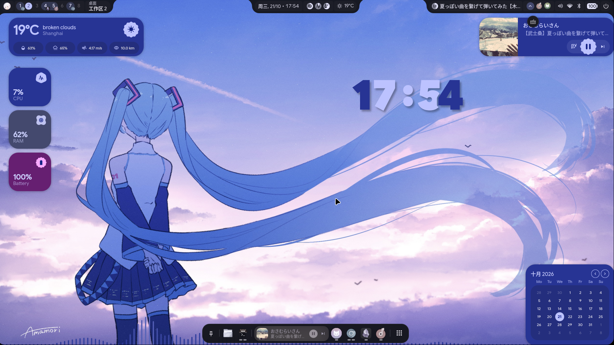
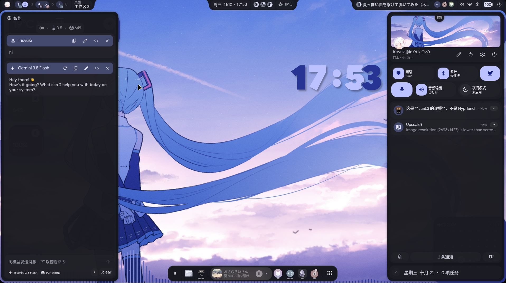
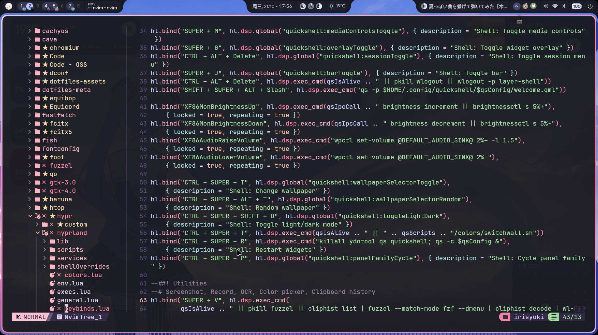

# Winter Iris Dotfiles

CachyOS / Arch Linux 的 Hyprland 桌面与开发配置。提供交互式安装器，并锁定外部源码和直接依赖版本。

## 预览

[](dotfiles-assets/gallery/desktop1.png)

<table>
  <tr>
    <td width="50%">
      <a href="dotfiles-assets/gallery/desktop2.png">
        
      </a>
    </td>
    <td width="50%">
      <a href="dotfiles-assets/gallery/nvim.png">
        
      </a>
    </td>
  </tr>
  <tr>
    <td align="center">Quickshell 侧栏</td>
    <td align="center">Neovim 开发环境</td>
  </tr>
</table>

## 组成

| 用途 | 组件 |
| --- | --- |
| 桌面 | Hyprland、Hyprlock、Quickshell `end4-pC` / `ii`、Fuzzel、Wlogout |
| 外观 | Matugen、Illogical Impulse、GTK 3/4、Kvantum、KDE Colors、Fontconfig |
| 终端 | Fish、Kitty、Starship、Zsh 配置片段 |
| 开发 | Neovim / NvChad |
| 工具 | btop、Cava、Fastfetch、mpv |
| 资源 | 头像、默认壁纸、MIME 文件关联 |

安装清单见 [`dotfiles-meta/config.lock`](dotfiles-meta/config.lock)，软件包版本见 [`dotfiles-meta/packages.lock`](dotfiles-meta/packages.lock)。

## 安装

```bash
git clone https://github.com/Winter-Iris/dotfile.git ~/dotfile
cd ~/dotfile
./install.sh
```

安装器启动后可选择：

- 安装仓库配置
- 下载固定版本的 Quickshell 配置
- 跳过、核对或安装依赖

直接运行 `./install.sh` 并按提示选择即可。覆盖前的配置保存在 `~/.local/state/dotfiles/backups/`。依赖自动安装仅支持 CachyOS。

### end4-pC 自定义组件

仓库的 [`dotfiles-custom/end4-pC`](dotfiles-custom/end4-pC/README.md) 独立保存自定义小组件、原组件样式覆盖和设置页面。运行 `./install.sh` 安装配置时，如果目标目录已有 `end4-pC`（包括本次选择下载的版本），安装器会自动接入自定义层。也可从本仓库手动运行：

```bash
./dotfiles-custom/end4-pC/install-custom.sh
```

脚本会将自定义代码复制到 `~/.config/quickshell/end4-pC/custom/`，并为 Settings 和通知中心加入小型加载接口；可重复运行。打开 Settings → 自定义组件，可切换通知中心的自定义无通知样式（`notification_empty.png`、“暂无通知 / 好好休息一下吧~”），关闭开关则恢复上游样式。设置值单独保存在 `~/.config/illogical-impulse/custom-components.json`，不写入上游配置。

自定义代码以仓库中的目录为准，不要直接编辑安装后的副本。单独更新上游 `end4-pC` 后重新运行上述脚本；如果接口补丁与新版代码冲突，脚本会停止，需要先调整补丁再安装。

## 壁纸

安装 `end4-pC` 配置后，可在 Fish 中用 `wallpaper` 切换图片或视频，无须启动 Quickshell：

```fish
wallpaper ~/Pictures/wallpaper.jpg
wallpaper ~/Videos/wallpaper.mp4
wallpaper "$HOME/Videos/Live Wallpapers/miku.webm"
```

命令支持 PNG、JPG、JPEG、WebP、BMP 图片，以及 MP4、MKV、WebM、MOV、AVI 视频。

Quickshell 壁纸选择器同样支持视频：将视频放在图片目录下的 `Wallpapers` 文件夹，或在选择器中打开视频所在目录，即可看到带缩略图和播放标识的视频卡片，选中后切换。

两种入口共用切换脚本，避免并发切换互相覆盖。视频由 `mpvpaper` 播放，FFmpeg 生成侧栏封面；相关依赖见 [`packages.lock`](dotfiles-meta/packages.lock)。选择安装 Quickshell 时，安装器会应用仓库中的 [end4-pC 壁纸补丁](dotfiles-meta/patches/end4-pC.patch)。更新上游版本后需重新检查该补丁。

## 上游

| 项目 | 用途 |
| --- | --- |
| [end-4/dots-hyprland](https://github.com/end-4/dots-hyprland) | Illogical Impulse、Quickshell `ii` 和构建配置 |
| [pctrade/end4-pC](https://github.com/pctrade/end4-pC) | Quickshell `end4-pC` |
| [NvChad/NvChad](https://github.com/NvChad/NvChad) | Neovim 配置框架 |
| [folke/lazy.nvim](https://github.com/folke/lazy.nvim) | Neovim 插件管理 |
| [trygveaa/kitty-kitten-search](https://github.com/trygveaa/kitty-kitten-search) | Kitty 搜索 kitten |
| [nwg-piotr/nwg-displays](https://github.com/nwg-piotr/nwg-displays) | 显示器和工作区配置生成器 |

Quickshell 的提交由 [`config.lock`](dotfiles-meta/config.lock) 固定；Neovim 插件的提交由 [`lazy-lock.json`](nvim/lazy-lock.json) 固定。安装时不会自动跟随上游分支。

## 可复现范围

- 本地配置和 Quickshell 源码使用完整 Git 提交哈希固定。
- 直接依赖精确到软件包版本；软件源版本不一致时，安装器会在修改系统前停止。
- 仓库包含默认头像和壁纸，并在安装时将个人主目录路径替换为当前 `$HOME`。
- 私人媒体、应用运行数据和机器专属配置不在安装清单中。

这套锁文件用于复现桌面与开发环境，不包含完整操作系统状态。滚动更新后若锁定版本已从软件源移除，需要先更新并重新验证锁文件。

## 更新

更新系统并确认桌面工作正常后，刷新软件包锁：

```bash
./scripts/update-lock.sh
git diff -- dotfiles-meta/packages.lock
```

Quickshell 更新需要修改 [`config.lock`](dotfiles-meta/config.lock) 中的提交哈希，并在隔离环境中验证。
